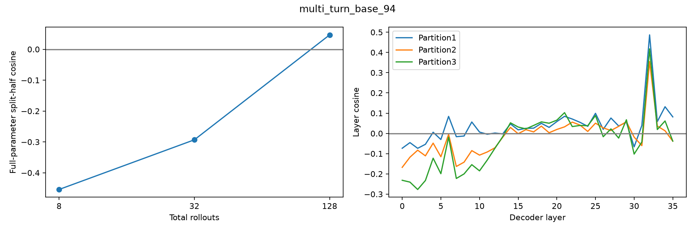

# multi_turn_base_94 — base reward gradient

128条rollout，成功39/128。所有reasoning保留，使用完整参数梯度。

| 总rollouts | 半组成功A/B | split-half cosine | 范数A | 范数B |
|---:|---|---:|---:|---:|
| 8 | 1/4 ; 1/4 | -0.45406 | 11188.124 | 10113.499 |
| 32 | 4/16 ; 7/16 | -0.29320 | 4553.596 | 5154.136 |
| 128 | 17/64 ; 22/64 | 0.04665 | 1985.610 | 2056.631 |

| 固定64+64分组 | A/B成功数 | cosine |
|---|---|---:|
| 1: [0, 1] vs [2, 3] | 17 / 22 | 0.04665 |
| 2: [0, 2] vs [1, 3] | 18 / 21 | -0.00656 |
| 3: [0, 3] vs [1, 2] | 18 / 21 | -0.01533 |

平均输出tokens：5513；输出达到长度上限的调用：0。

undefined表示至少一半的梯度为零，不能写成cosine=0；三种分组共享数据，不是三次独立重复。

- Only8 sampled questions, descriptive variation not population inference.
- Three final partitions share rollouts and nested prefixes share data.
- HF/vLLM numerical differences remain; same validated harness/input replay as earlier studies.
- No training, candidate scoring or data selection in this diagnostic.

## 题目与失败分布

首个失败类型：`{"multi_turn:instance_state_mismatch": 89}`
首个失败轮次：`{"unspecified": 89}`
固定样例规则：每种reward取最小repeat编号，见result.json的representative_repeat_by_reward；原文在对应rollout记录的看板轨迹中。

- User turn0: Hello! I'm laying out a detailed plan for an extended road trip and need to verify if my car can endure a stretch of over 300 miles without requiring a pit stop for gas. Check the stats for me, would you? Should the range fall short, go ahead and top off the fuel tank with 30 gallons to ensure we're in the clear.
- User turn1: Additionally, before hitting the road, do me a favor and verify the tire pressures. Should any tire fall below the 40 PSI mark, kindly pinpoint the nearest tire shop for me and set navigation.
- User turn2: Finally, I've double-checked that all vehicle portals are locked and secure, and the parking brake's in place. Can you proceed to ignite the engine?
