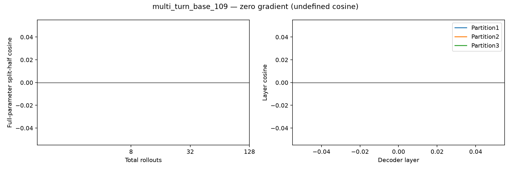

# multi_turn_base_109 — base reward gradient

128条rollout，成功0/128。所有reasoning保留，使用完整参数梯度。

| 总rollouts | 半组成功A/B | split-half cosine | 范数A | 范数B |
|---:|---|---:|---:|---:|
| 8 | 0/4 ; 0/4 | undefined | 0.000 | 0.000 |
| 32 | 0/16 ; 0/16 | undefined | 0.000 | 0.000 |
| 128 | 0/64 ; 0/64 | undefined | 0.000 | 0.000 |

| 固定64+64分组 | A/B成功数 | cosine |
|---|---|---:|
| 1: [0, 1] vs [2, 3] | 0 / 0 | undefined |
| 2: [0, 2] vs [1, 3] | 0 / 0 | undefined |
| 3: [0, 3] vs [1, 2] | 0 / 0 | undefined |

平均输出tokens：5844；输出达到长度上限的调用：0。

undefined表示至少一半的梯度为零，不能写成cosine=0；三种分组共享数据，不是三次独立重复。

- Only8 sampled questions, descriptive variation not population inference.
- Three final partitions share rollouts and nested prefixes share data.
- HF/vLLM numerical differences remain; same validated harness/input replay as earlier studies.
- No training, candidate scoring or data selection in this diagnostic.

## 题目与失败分布

首个失败类型：`{"multi_turn:execution_response_mismatch": 101, "multi_turn:empty_turn_model_response": 27}`
首个失败轮次：`{"3": 128}`
固定样例规则：每种reward取最小repeat编号，见result.json的representative_repeat_by_reward；原文在对应rollout记录的看板轨迹中。

- User turn0: I heard that the technology sector is booming these days. Get me a list of potential tech stocks I could invest in.
- User turn1: From the tech stocks available, let's dive into one that catches my eye. Grab the latest market data for this stock 'MSFT'. I'm thinking about acquiring it.
- User turn2: The data looks promising! Go ahead and execute a buy order for 100 shares of this stock at the current market price.
- User turn3: Can you fetch the details for the order I just placed? I want to ensure everything is accurate.
- User turn4: Actually, I've changed my mind about this transaction. Could you cancel the recent order for me?
- User turn5: Since we're sorting out my investments, please give me an overview of my account, especially the available balance and linked card details.
- User turn6: Could you also compose and send out a tweet 'Just made a move in the tech sector! I initiated and then canceled a 100-share buy order for $MSFT. Always staying sharp with my investment decisions!' sharing my latest investment move to my followers?
