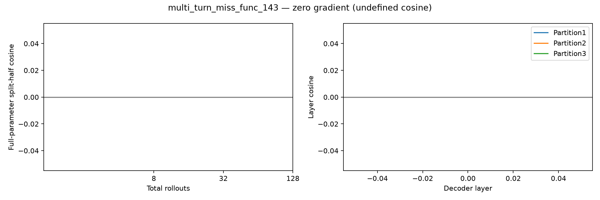

# multi_turn_miss_func_143 — base reward gradient

128条rollout，成功0/128。所有reasoning保留，使用完整参数梯度。

| 总rollouts | 半组成功A/B | split-half cosine | 范数A | 范数B |
|---:|---|---:|---:|---:|
| 8 | 0/4 ; 0/4 | undefined | 0.000 | 0.000 |
| 32 | 0/16 ; 0/16 | undefined | 0.000 | 0.000 |
| 128 | 0/64 ; 0/64 | undefined | 0.000 | 0.000 |

| 固定64+64分组 | A/B成功数 | cosine |
|---|---|---:|
| 1: [0, 1] vs [2, 3] | 0 / 0 | undefined |
| 2: [0, 2] vs [1, 3] | 0 / 0 | undefined |
| 3: [0, 3] vs [1, 2] | 0 / 0 | undefined |

平均输出tokens：5252；输出达到长度上限的调用：1。

undefined表示至少一半的梯度为零，不能写成cosine=0；三种分组共享数据，不是三次独立重复。

- Only8 sampled questions, descriptive variation not population inference.
- Three final partitions share rollouts and nested prefixes share data.
- HF/vLLM numerical differences remain; same validated harness/input replay as earlier studies.
- No training, candidate scoring or data selection in this diagnostic.

## 题目与失败分布

首个失败类型：`{"multi_turn:empty_turn_model_response": 108, "multi_turn:execution_response_mismatch": 19, "multi_turn:instance_state_mismatch": 1}`
首个失败轮次：`{"1": 127, "unspecified": 1}`
固定样例规则：每种reward取最小repeat编号，见result.json的representative_repeat_by_reward；原文在对应rollout记录的看板轨迹中。

- User turn0: I have recently come across Zeta Corp and I'm intrigued by their operations. Kindly include their stock in my watchlist so that I can monitor it.
- User turn1: I've been following a few orders and aim to review the specifics of one with a substantial order value I remember initiating. Let's retrieve the details.
- User turn2: With the recent market movements, my strategies are up for reevaluation. Proceed by cancelling the specific order we've just reviewed, given the uncertainties surrounding its outcome.
- User turn3: 
- User turn4: I require some confidence about my current financial positioning. Share a detailed overview of my account, including balances and any associated card numbers. Furthermore, logging in as USR001 to notify my financial advisor (user id 'USR003') promptly about this potential shift in my investment strategy with our latest account details. The message should be like 'My strategy is shifting due to recent market movements and the cancellation of a specific order. Current balance in my account is $10000.'
