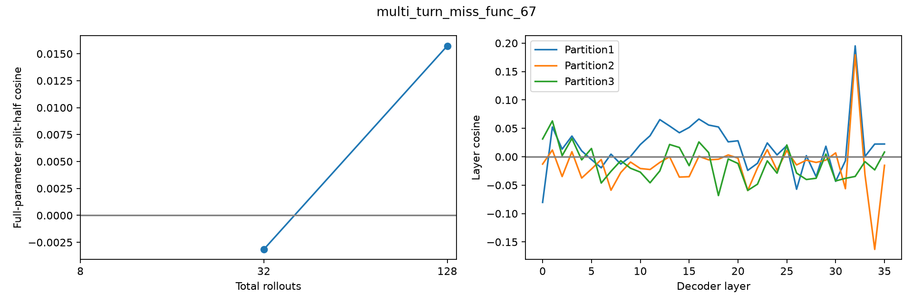

# multi_turn_miss_func_67 — base reward gradient

128条rollout，成功23/128。所有reasoning保留，使用完整参数梯度。

| 总rollouts | 半组成功A/B | split-half cosine | 范数A | 范数B |
|---:|---|---:|---:|---:|
| 8 | 0/4 ; 1/4 | undefined | 0.000 | 8013.773 |
| 32 | 1/16 ; 2/16 | -0.00315 | 2479.478 | 3087.773 |
| 128 | 12/64 ; 11/64 | 0.01573 | 1870.959 | 1821.133 |

| 固定64+64分组 | A/B成功数 | cosine |
|---|---|---:|
| 1: [0, 1] vs [2, 3] | 12 / 11 | 0.01573 |
| 2: [0, 2] vs [1, 3] | 8 / 15 | -0.01398 |
| 3: [0, 3] vs [1, 2] | 11 / 12 | -0.02070 |

平均输出tokens：7028；输出达到长度上限的调用：0。

undefined表示至少一半的梯度为零，不能写成cosine=0；三种分组共享数据，不是三次独立重复。

- Only8 sampled questions, descriptive variation not population inference.
- Three final partitions share rollouts and nested prefixes share data.
- HF/vLLM numerical differences remain; same validated harness/input replay as earlier studies.
- No training, candidate scoring or data selection in this diagnostic.

## 题目与失败分布

首个失败类型：`{"multi_turn:instance_state_mismatch": 74, "multi_turn:empty_turn_model_response": 19, "multi_turn:execution_response_mismatch": 12}`
首个失败轮次：`{"unspecified": 74, "1": 27, "2": 3, "3": 1}`
固定样例规则：每种reward取最小repeat编号，见result.json的representative_repeat_by_reward；原文在对应rollout记录的看板轨迹中。

- User turn0: Will you estimate the distance between San Francisco and Silverpine for me?
- User turn1: 
- User turn2: I need that info to check if my vehicle can cover the distance without refueling.
- User turn3: In case it can't, just fill out the fuel tank completely.
- User turn4: Turn on my vehicle's engine in 'START' mode.
