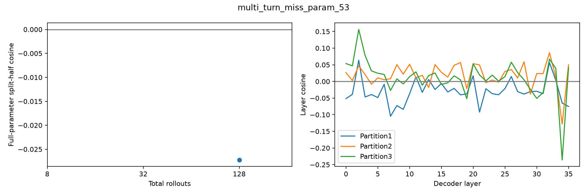

# multi_turn_miss_param_53 — base reward gradient

128条rollout，成功7/128。所有reasoning保留，使用完整参数梯度。

| 总rollouts | 半组成功A/B | split-half cosine | 范数A | 范数B |
|---:|---|---:|---:|---:|
| 8 | 2/4 ; 0/4 | undefined | 9256.638 | 0.000 |
| 32 | 2/16 ; 0/16 | undefined | 3082.314 | 0.000 |
| 128 | 6/64 ; 1/64 | -0.02724 | 1330.982 | 568.933 |

| 固定64+64分组 | A/B成功数 | cosine |
|---|---|---:|
| 1: [0, 1] vs [2, 3] | 6 / 1 | -0.02724 |
| 2: [0, 2] vs [1, 3] | 5 / 2 | 0.02089 |
| 3: [0, 3] vs [1, 2] | 4 / 3 | 0.01135 |

平均输出tokens：7068；输出达到长度上限的调用：25。

undefined表示至少一半的梯度为零，不能写成cosine=0；三种分组共享数据，不是三次独立重复。

- Only8 sampled questions, descriptive variation not population inference.
- Three final partitions share rollouts and nested prefixes share data.
- HF/vLLM numerical differences remain; same validated harness/input replay as earlier studies.
- No training, candidate scoring or data selection in this diagnostic.

## 题目与失败分布

首个失败类型：`{"multi_turn:instance_state_mismatch": 120, "multi_turn:empty_turn_model_response": 1}`
首个失败轮次：`{"unspecified": 120, "4": 1}`
固定样例规则：每种reward取最小repeat编号，见result.json的representative_repeat_by_reward；原文在对应rollout记录的看板轨迹中。

- User turn0: First, you need to know how much gasoline you added to your car, expressed in liters. You've just filled up with 30 gallons, so how many liters of fuel does that equate to?
- User turn1: Let's take the initiative to start the engine in start mode. We want to ascertain that it operates smoothly with the increased fuel level.
- User turn2: Inspect each tire's condition and confirm they are in optimal shape.
- User turn3: Upon verifying the tire pressure, we should share our findings on Twitter to keep everyone informed. Post the tweet message 'Tire pressures are optimal!'. Utilize hashtags #CarMaintenance and tag my friend's account for professional insights.
- User turn4: The account you need to tag is 'VehicleGuru'.
