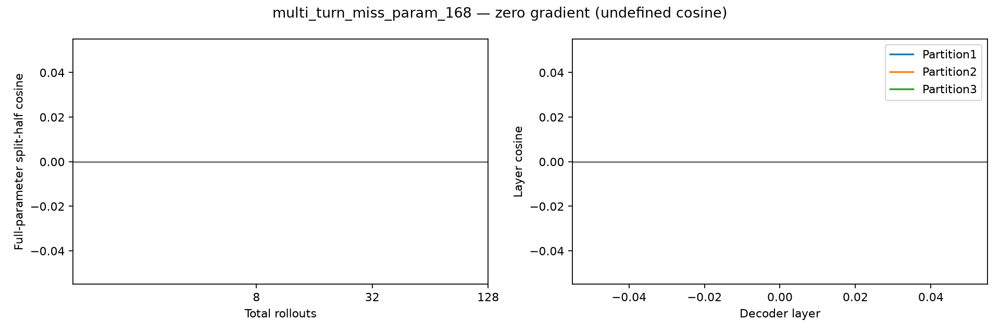

# multi_turn_miss_param_168 — base reward gradient

128条rollout，成功0/128。所有reasoning保留，使用完整参数梯度。

| 总rollouts | 半组成功A/B | split-half cosine | 范数A | 范数B |
|---:|---|---:|---:|---:|
| 8 | 0/4 ; 0/4 | undefined | 0.000 | 0.000 |
| 32 | 0/16 ; 0/16 | undefined | 0.000 | 0.000 |
| 128 | 0/64 ; 0/64 | undefined | 0.000 | 0.000 |

| 固定64+64分组 | A/B成功数 | cosine |
|---|---|---:|
| 1: [0, 1] vs [2, 3] | 0 / 0 | undefined |
| 2: [0, 2] vs [1, 3] | 0 / 0 | undefined |
| 3: [0, 3] vs [1, 2] | 0 / 0 | undefined |

平均输出tokens：4010；输出达到长度上限的调用：0。

undefined表示至少一半的梯度为零，不能写成cosine=0；三种分组共享数据，不是三次独立重复。

- Only8 sampled questions, descriptive variation not population inference.
- Three final partitions share rollouts and nested prefixes share data.
- HF/vLLM numerical differences remain; same validated harness/input replay as earlier studies.
- No training, candidate scoring or data selection in this diagnostic.

## 题目与失败分布

首个失败类型：`{"multi_turn:execution_response_mismatch": 120, "multi_turn:instance_state_mismatch": 8}`
首个失败轮次：`{"5": 120, "unspecified": 8}`
固定样例规则：每种reward取最小repeat编号，见result.json的representative_repeat_by_reward；原文在对应rollout记录的看板轨迹中。

- User turn0: Calculate the exchange rate for 1500 USD for me, I have some funds to convert quickly.
- User turn1: To EUR please
- User turn2: Now that I have the converted amount, orchestrate the reservation of a flight this weekend July 1st 2024 from San Francisco to Boston in the business class category, utilizing my access token 'abc123xyz456', and ensure it is billed to my primary credit card logged with id 'card5638'.
- User turn3: Once the flight arrangement has been secured, retrieve the invoice particulars so I can log them for my budgetary purposes.
- User turn4: To resolve some complications I encountered during my booking, kindly reach out to customer support and convey that I 'Require assistance with the transaction particulars'.
- User turn5: Upon reaching out to customer support, dispatch a concise message through my account with id 'USR100145' to my advisor with id 'travel_advisor', conveying the specifics of the problems I faced. They are anticipating this communication promptly. The message you send should be 'Details regarding problems faced with the flight booking transaction.'
