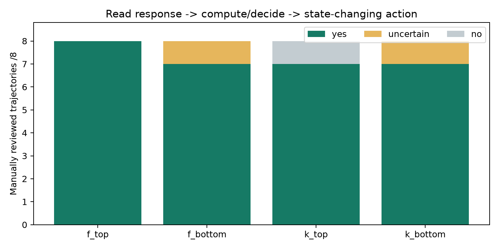

# Top/bottom对照：宽泛工具工作流是否有区分力

**结论：bottom中也大量存在这一流程，当前审查不能支持用它解释top的优势。此前仅看top8的共同点不足以建立这种解释。**

固定范围：第二题67的F128/K128，各最高8条和最低8条，共32个组内位置、28条不同轨迹。没有挑选其中符合预期的样例；本次不是对完整200条的语义普查。

为避免仅凭工具名或先后顺序贴标签，采用更严格的判据：只读查询的返回信息被用于计算写入参数、筛选操作对象或判断后续状态修改的条件。单纯“先查后写”不够；后续用户完整重新给定操作的边界案例单列不确定。这个标准比原先“执行操作”更窄；满足它的bottom当然也满足原先宽泛描述。

| 配置 | 明确存在 | 不存在明确证据链 | 不确定 |
|---|---:|---:|---:|
| f_top | 8/8 | 0/8 | 0/8 |
| f_bottom | 7/8 | 0/8 | 1/8 |
| k_top | 7/8 | 1/8 | 0/8 |
| k_bottom | 7/8 | 0/8 | 1/8 |

不确定案例：F bottom的2102先查询得到比赛M4，后续用户又完整指定M4和新地点；K bottom的8889先读病房状态，但用户已明确给定状态与所有操作对象。保守口径下不计为明确存在。K top第一名1449主要是用户逐轮补齐参数后创建/修改，export查询没有明确驱动后续写操作。

## 明确的bottom反例

| ID | 第二题排名（1最好/200最差） | 真实链条 |
|---|---|---|
| 8710 | F197 / K200 | 查询员工工资及岗位薪资区间 → 计算20%涨薪、比较晋升阈值 → 更新工资/职位 |
| 1594 | F199 | 查询坐标55.7/37.6 → 各加0.01 → 写回55.71/37.61 |
| 4357 | F195 / K197 | 查询NAV=50 → 计算增加2% → 更新为51 |
| 4579 | K198 | 查询月租2600、日租100 → 月租上调5% → 写回2730并保留日租100 |
| 4582 | F200 | 租期校验失败 → 查询最低30天 → 改结束日期重新校验 → 计算租金并提交 |
| 8406 | K196 | 按内容/标签查询笔记 → 利用返回ID、标题、正文 → 编辑和复制到Archive |

4582的参数修复还会改变用户给定日期，7578中存在available=False却继续改期的行为。模式存在不等于操作正确、数据优质或有正训练收益；同一条轨迹可以同时有有用和有害行为。

## 同一内容随probe换排名

8710在Q1 F排名4，但在第二题F/K分别排名197/200；4582在Q1 K排名1，但在第二题F排名200。流程特征本身没变。此现象不证明梯度排名没有信号，但说明不能用这个粗粒度标签解释排名差别。

同环境也有相反排名：第二题F top1的6099和bottom2的1594都是env_50_sft的动物观察环境，后者甚至有更直接的查询数值→算术更新链。

## probe本身的核验

第二题K梯度只取turn1，实际链条是查询两个城市的邮编→把返回邮编传给estimate_distance；没有油箱状态修改，也没有后续加油纠错。成功probe r018和失败probe r001都有这一调用链，所以该泛化模式也不能充分区分probe成功与失败。它们的整题reward包含后续回合结果。

F包含完整轨迹；成功probe r018在加油回合查询油量后传39.5，失败r001先传50，查询到10.5后仍没有正确补加。这个具体执行差异是真实的，但不能据此推断top训练数据更富含宽泛查询/操作模式。

## 逐条判定

### f_top

| 组内排名 | ID | 判定 | 理由 |
|---|---:|---|---|
| 1 | 6099 | yes | 查重返回is_duplicate=False，然后添加对应观察记录；包含状态判定。 |
| 2 | 685 | yes | 读取报价和持仓，使用返回报价卖出并根据所得金额计算后续可购买数量。 |
| 3 | 7568 | yes | 原房不可用、替代房可用，据此取消原预订并创建替代预订；不代表冲突ID重试均优质。 |
| 4 | 8235 | yes | 读取指定翻译，返回非空译文和状态后审批；查询结果验证操作前提。 |
| 5 | 4398 | yes | 查询任务列表和状态，对符合条件的任务完成/解阻塞。 |
| 6 | 2069 | yes | 查询moderator，依据last_login为空的返回字段选择davidx并锁定，排除已登录者。 |
| 7 | 6752 | yes | 查询来源可靠性、区域价格和实际source ID，将查询返回值用于新增记录；计算/过滤是否完全满足用户要求是另一问题。 |
| 8 | 918 | yes | 用户只给研究名称，查询研究列表取得匹配研究ID STUDY004，再执行入组。 |

### f_bottom

| 组内排名 | ID | 判定 | 理由 |
|---|---:|---|---|
| 1 | 4582 | yes | 租期检查失败后查询最低30天，调整结束日，通过验证后计算租金并提交租赁询问；该修正也改变了用户给定日期。 |
| 2 | 1594 | yes | 查询坐标55.7/37.6，分别加0.01并写回55.71/37.61；明确数值依赖。 |
| 3 | 2102 | uncertain | 先查询比赛并报告M4，随后用户再次完整指定M4和新地点。流程上读后写明确，但无法明确排除后续写操作完全由用户新指令决定。 |
| 4 | 8710 | yes | 查询员工工资和岗位工资区间，计算20%涨薪，比较晋升阈值再更新；完整满足被检验流程。 |
| 5 | 8925 | yes | 查询round_number为1、2，创建下一轮3；遇到round ID冲突还更换ID重试。 |
| 6 | 4357 | yes | 查询NAV=50，按用户要求增加2%，写回51。 |
| 7 | 8549 | yes | 检查传感器/设备是否注册，收到False后注册；属于状态判断驱动操作。 |
| 8 | 1813 | yes | 查询旧时间戳1700003600，与新时间戳1700022000比较，确认更新适当后导入。 |

### k_top

| 组内排名 | ID | 判定 | 理由 |
|---|---:|---|---|
| 1 | 1449 | no | 写操作主要由用户逐轮提供完整参数；唯一export读取用于输出，后续建套件/移除测试的参数由用户重新完整指定。未找到明确查询返回值驱动写操作的链。 |
| 2 | 4577 | yes | 查询房源和最低租期，区分30天和7天条件，选择合适房源并激活/修改日历；含错误恢复，但非全程无误。 |
| 3 | 41 | yes | 列表返回具体任务，读取任务状态后完成；另有查询项目日期再调整任务日期的链。 |
| 4 | 8235 | yes | 读取指定翻译，返回非空译文和状态后审批；查询结果验证操作前提。 |
| 5 | 2782 | yes | 查询任务及最新执行记录，依据失败状态和下次运行时间选择TASK004删除；没有执行历史/超出时间窗的对象不删除。 |
| 6 | 957 | yes | 查询商品返回价格799.99和199.95，按20%折扣更新为639.99和159.96。 |
| 7 | 4036 | yes | 读取预算15000/8000，按转移2000计算并更新为17000/6000。 |
| 8 | 2069 | yes | 查询moderator，依据last_login为空的返回字段选择davidx并锁定，排除已登录者。 |

### k_bottom

| 组内排名 | ID | 判定 | 理由 |
|---|---:|---|---|
| 1 | 8710 | yes | 查询员工工资和岗位工资区间，计算20%涨薪，比较晋升阈值再更新；完整满足被检验流程。 |
| 2 | 7578 | yes | 查询可用房间取得房间ID及价格，用于预订和后续调价；另有明知available=False仍改期的坏行为，不影响该模式存在。 |
| 3 | 4579 | yes | 查询月租2600、日租100，月租上调5%为2730并保留日租100后写回。 |
| 4 | 4357 | yes | 查询NAV=50，按用户要求增加2%，写回51。 |
| 5 | 8406 | yes | 搜索返回真实note_id并编辑；按标签读取现有笔记的标题/正文，再创建Archive副本。 |
| 6 | 4318 | yes | 查询给定日期榜单不存在，判定可以创建后建立新榜单；后续也查询歌曲信息再导入榜单。 |
| 7 | 8889 | uncertain | 先读取病房状态再恢复/转移，但用户已给出maintenance状态及全部操作对象。按严格判据，不能明确确定实际采用了新查询信息，而不只是依序照做。 |
| 8 | 4034 | yes | 查询教育比例，将associate改为0.18，依据其余返回比例重新归一并写回；也有查无统计后新增的链。 |

## 解释边界

- 这是事后、非盲审的固定极端样本检查，不是独立人工标注或全池显著性检验。
- 样本数小且F/K组重叠，不用不适当的独立样本p值宣称“全池完全相同”。
- 可以收回“这一宽泛特征解释top收益”的叙述；不能由此收回已观察到的K模型错误恢复改善，也不能证明梯度归因无效。
- 更有辨别力的假设需要检验具体错误→新增信息→正确参数修复，以及这些行为在训练损失中的权重，并在top/bottom同时测量。此处未额外启动训练。

[逐条标签与原文证据](annotations.json) · [完整轨迹](CASES.md) · [真实probe样例](probe-examples.json)
