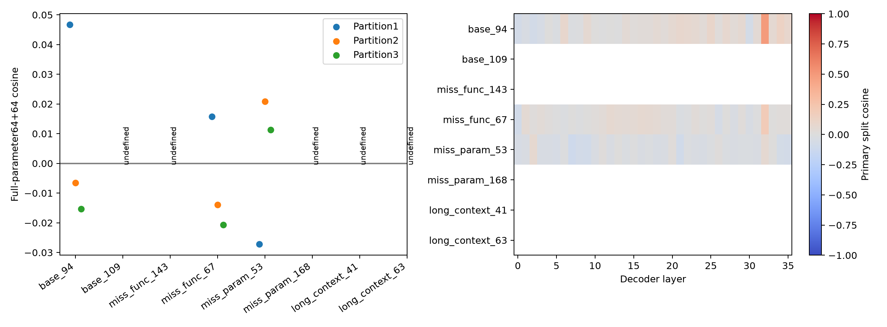

# BFCL不同题目的probe reward gradient稳定性

已分析8/8题；每题128条新rollout，base Qwen3-4B，完整reasoning、完整参数梯度。

| 题目 | 成功/128 | cosine8 | cosine32 | cosine128 | 三种最终划分cosine | 平均输出tokens |
|---|---:|---:|---:|---:|---|---:|
| multi_turn_base_94 | 39 | -0.45406 | -0.29320 | 0.04665 | 0.04665, -0.00656, -0.01533 | 5513 |
| multi_turn_base_109 | 0 | undefined | undefined | undefined | undefined, undefined, undefined | 5844 |
| multi_turn_miss_func_143 | 0 | undefined | undefined | undefined | undefined, undefined, undefined | 5252 |
| multi_turn_miss_func_67 | 23 | undefined | -0.00315 | 0.01573 | 0.01573, -0.01398, -0.02070 | 7028 |
| multi_turn_miss_param_53 | 7 | undefined | undefined | -0.02724 | -0.02724, 0.02089, 0.01135 | 7068 |
| multi_turn_miss_param_168 | 0 | undefined | undefined | undefined | undefined, undefined, undefined | 4010 |
| multi_turn_long_context_41 | 0 | undefined | undefined | undefined | undefined, undefined, undefined | 12108 |
| multi_turn_long_context_63 | 0 | undefined | undefined | undefined | undefined, undefined, undefined | 4292 |

题目按固定随机顺序展示；未按成功率或cosine筛题。恒定奖励组保留并记undefined。高cosine衡量方向重复性，不直接证明选样或训练收益。

- Only8 sampled questions, descriptive variation not population inference.
- Three final partitions share rollouts and nested prefixes share data.
- HF/vLLM numerical differences remain; same validated harness/input replay as earlier studies.
- No training, candidate scoring or data selection in this diagnostic.
