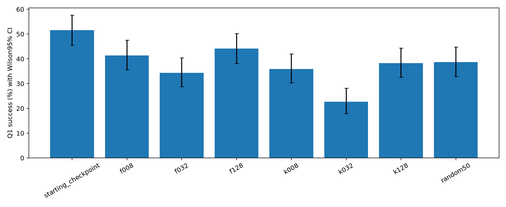

# Q1 continuation from random100 checkpoint

Six gradient-selected50 settings and one frozen random50 control; all restart the optimizer and scheduler and train2 more epochs from the same random100 weights. Probe and evaluation seeds are disjoint.

| Model | Successes /256 | Accuracy | Wilson95% |
|---|---:|---:|---:|
| starting_checkpoint | 132 | 51.56% | 45.46–57.62% |
| f008 | 106 | 41.41% | 35.54–47.52% |
| f032 | 88 | 34.38% | 28.83–40.39% |
| f128 | 113 | 44.14% | 38.19–50.27% |
| k008 | 92 | 35.94% | 30.31–41.98% |
| k032 | 58 | 22.66% | 17.95–28.17% |
| k128 | 98 | 38.28% | 32.54–44.37% |
| random50 | 99 | 38.67% | 32.92–44.76% |

| Model | Control | Delta pp | Paired95% pp | Holm13 p |
|---|---|---:|---:|---:|
| f008 | random50 | +2.73 | -5.86–+11.33 | 1 |
| f008 | starting_checkpoint | -10.16 | -18.75–-1.56 | 0.2042 |
| f032 | random50 | -4.30 | -12.51–+3.91 | 1 |
| f032 | starting_checkpoint | -17.19 | -25.00–-9.38 | 0.0003313 |
| f128 | random50 | +5.47 | -3.52–+14.06 | 1 |
| f128 | starting_checkpoint | -7.42 | -16.41–+1.56 | 0.7426 |
| k008 | random50 | -2.73 | -10.94–+5.47 | 1 |
| k008 | starting_checkpoint | -15.62 | -24.22–-7.03 | 0.006313 |
| k032 | random50 | -16.02 | -23.83–-8.20 | 0.001371 |
| k032 | starting_checkpoint | -28.91 | -36.72–-21.09 | 3.882e-10 |
| k128 | random50 | -0.39 | -7.81–+7.42 | 1 |
| k128 | starting_checkpoint | -13.28 | -21.48–-5.08 | 0.02396 |
| random50 | starting_checkpoint | -12.89 | -20.70–-4.69 | 0.02396 |

- Single training seed and single nested probe set; uncertainty intervals cover eval sampling only.
- Q1 is used for selector feedback and evaluation: deliberate targeted adaptation, not held-out task generalization.
- Candidate direction is raw mean-NLL SGD direction; actual SFT uses AdamW.
- HF/vLLM numerical log-prob differences from prior diagnostic remain.
- This is reuse of data already seen in the first SFT stage; test targeted reweighting/extra exposure, not selection from unseen data.
- All continuations reset optimizer/scheduler; continuation refers to weights.
