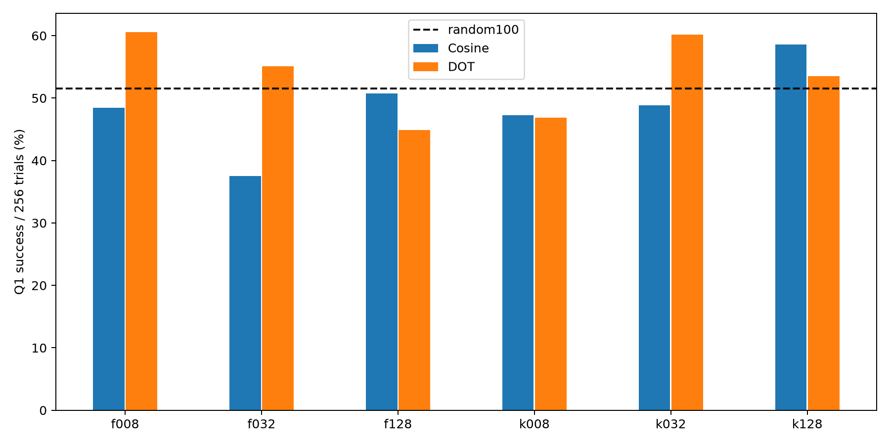

# Q1 dot selection from original base model

| Variant | Success /256 | Rate | Cosine rate |
|---|---:|---:|---:|
| f008 | 155 | 60.55% | 48.44% |
| f032 | 141 | 55.08% | 37.50% |
| f128 | 115 | 44.92% | 50.78% |
| k008 | 120 | 46.88% | 47.27% |
| k032 | 154 | 60.16% | 48.83% |
| k128 | 137 | 53.52% | 58.59% |

| Variant | Control | Delta pp | Paired95% pp | Holm p |
|---|---|---:|---:|---:|
| f008 | base | +19.14 | +10.94 to +27.34 | 0.0002495 |
| f008 | random100 | +8.98 | +0.78 to +17.19 | 0.4373 |
| f008 | matched_cosine | +12.11 | +3.91 to +20.31 | 0.08611 |
| f032 | base | +13.67 | +5.08 to +22.27 | 0.04574 |
| f032 | random100 | +3.52 | -5.08 to +12.11 | 1 |
| f032 | matched_cosine | +17.58 | +8.98 to +26.17 | 0.001897 |
| f128 | base | +3.52 | -5.47 to +12.50 | 1 |
| f128 | random100 | -6.64 | -14.84 to +1.95 | 1 |
| f128 | matched_cosine | -5.86 | -14.84 to +3.12 | 1 |
| k008 | base | +5.47 | -3.12 to +14.06 | 1 |
| k008 | random100 | -4.69 | -12.89 to +3.52 | 1 |
| k008 | matched_cosine | -0.39 | -8.59 to +7.81 | 1 |
| k032 | base | +18.75 | +10.55 to +26.95 | 0.0003879 |
| k032 | random100 | +8.59 | +0.39 to +16.80 | 0.5478 |
| k032 | matched_cosine | +11.33 | +2.34 to +20.31 | 0.1785 |
| k128 | base | +12.11 | +3.12 to +20.70 | 0.1315 |
| k128 | random100 | +1.95 | -6.25 to +10.55 | 1 |
| k128 | matched_cosine | -5.08 | -14.06 to +3.52 | 1 |

- Single training seed and single nested probe set; uncertainty intervals cover eval sampling only.
- Q1 is used for selector feedback and evaluation: deliberate targeted adaptation, not held-out task generalization.
- Candidate direction is raw mean-NLL SGD direction; actual SFT uses AdamW.
- HF/vLLM numerical log-prob differences from prior diagnostic remain.
- Follow-up design after cosine outcomes were inspected; report all six configurations.
- Same targeted Q1 repeated evaluation, not benchmark generalization.
