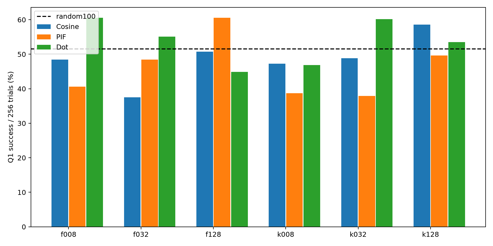

# Q1 pif selection from original base model

| Variant | Success /256 | Rate | Cosine rate |
|---|---:|---:|---:|
| f008 | 104 | 40.62% | 48.44% |
| f032 | 124 | 48.44% | 37.50% |
| f128 | 155 | 60.55% | 50.78% |
| k008 | 99 | 38.67% | 47.27% |
| k032 | 97 | 37.89% | 48.83% |
| k128 | 127 | 49.61% | 58.59% |

| Variant | Control | Delta pp | Paired95% pp | Holm p |
|---|---|---:|---:|---:|
| f008 | base | -0.78 | -8.98 to +7.42 | 1 |
| f008 | random100 | -10.94 | -19.53 to -2.34 | 0.2949 |
| f008 | matched_cosine | -7.81 | -16.41 to +0.78 | 0.788 |
| f008 | matched_dot | -19.92 | -28.52 to -11.33 | 0.0002649 |
| f032 | base | +7.03 | -1.56 to +15.62 | 1 |
| f032 | random100 | -3.12 | -11.72 to +5.47 | 1 |
| f032 | matched_cosine | +10.94 | +3.12 to +18.75 | 0.1515 |
| f032 | matched_dot | -6.64 | -15.62 to +2.34 | 1 |
| f128 | base | +19.14 | +10.94 to +27.34 | 0.000305 |
| f128 | random100 | +8.98 | +0.78 to +17.19 | 0.6559 |
| f128 | matched_cosine | +9.77 | +1.56 to +17.97 | 0.4107 |
| f128 | matched_dot | +15.62 | +7.03 to +24.22 | 0.01756 |
| k008 | base | -2.73 | -11.33 to +5.86 | 1 |
| k008 | random100 | -12.89 | -20.70 to -5.08 | 0.04835 |
| k008 | matched_cosine | -8.59 | -17.19 to +0.00 | 0.781 |
| k008 | matched_dot | -8.20 | -16.41 to +0.00 | 0.781 |
| k032 | base | -3.52 | -11.72 to +4.69 | 1 |
| k032 | random100 | -13.67 | -21.88 to -5.08 | 0.04835 |
| k032 | matched_cosine | -10.94 | -19.14 to -2.34 | 0.2409 |
| k032 | matched_dot | -22.27 | -30.86 to -13.28 | 5.977e-05 |
| k128 | base | +8.20 | -0.39 to +16.80 | 0.781 |
| k128 | random100 | -1.95 | -10.55 to +6.64 | 1 |
| k128 | matched_cosine | -8.98 | -17.19 to -0.39 | 0.6559 |
| k128 | matched_dot | -3.91 | -12.89 to +4.70 | 1 |

- Single training seed and single nested probe set; uncertainty intervals cover eval sampling only.
- Q1 is used for selector feedback and evaluation: deliberate targeted adaptation, not held-out task generalization.
- Candidate direction is raw mean-NLL SGD direction; actual SFT uses AdamW.
- HF/vLLM numerical log-prob differences from prior diagnostic remain.
- Follow-up design after cosine outcomes were inspected; report all six configurations.
- Same targeted Q1 repeated evaluation, not benchmark generalization.
- Empirical gradient-outer-product curvature, not exact Hessian.
- Base model is not an optimum of candidate200 SFT; this is a preconditioned attribution heuristic, not a classical stationary influence guarantee.
- Projection fidelity gate tests numerical approximation, not causal downstream attribution quality.
- Two-sided JL and blockwise inverse adapt LoRIF; no reproduction claim for its GPT2 results.
- Damping held fixed to reference512; explicit deviation from recomputing trace/projected_dimension at each dimension.
