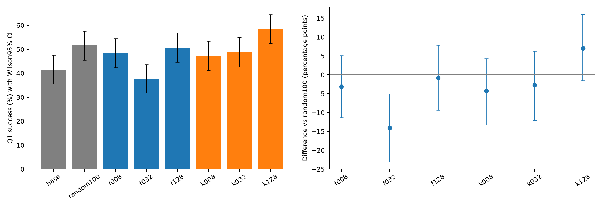

# Q1 single-question selection: F/K × 8/32/128

All current reasoning retained. Fresh evaluation uses256 trials/model and a disjoint seed namespace. This is targeted same-question adaptation; intervals cover evaluation sampling, not training-seed or task variability.

| Model | Successes /256 | Success rate | Wilson95% |
|---|---:|---:|---:|
| base | 106 | 41.41% | 35.54–47.52% |
| random100 | 132 | 51.56% | 45.46–57.62% |
| f008 | 124 | 48.44% | 42.38–54.54% |
| f032 | 96 | 37.50% | 31.80–43.57% |
| f128 | 130 | 50.78% | 44.69–56.85% |
| k008 | 121 | 47.27% | 41.24–53.38% |
| k032 | 125 | 48.83% | 42.77–54.92% |
| k128 | 150 | 58.59% | 52.48–64.46% |

| Selected model | Control | Difference pp | Paired bootstrap95% pp | Holm12 p |
|---|---|---:|---:|---:|
| f008 | random100 | -3.12 | -11.33–+5.08 | 1 |
| f032 | random100 | -14.06 | -23.05–-5.08 | 0.0303 |
| f128 | random100 | -0.78 | -9.38–+7.81 | 1 |
| k008 | random100 | -4.30 | -13.28–+4.30 | 1 |
| k032 | random100 | -2.73 | -12.11–+6.25 | 1 |
| k128 | random100 | +7.03 | -1.56–+16.02 | 1 |
| f008 | base | +7.03 | -1.57–+15.62 | 1 |
| f032 | base | -3.91 | -12.50–+4.69 | 1 |
| f128 | base | +9.38 | +0.78–+17.58 | 0.3845 |
| k008 | base | +5.86 | -2.73–+14.45 | 1 |
| k032 | base | +7.42 | -1.17–+16.02 | 1 |
| k128 | base | +17.19 | +8.98–+25.39 | 0.000875 |

Selection overlap, full score correlations, exact outcomes and provenance: [result.json](result.json).

- Single training seed and single nested probe set; uncertainty intervals cover eval sampling only.
- Q1 is used for selector feedback and evaluation: deliberate targeted adaptation, not held-out task generalization.
- Candidate direction is raw mean-NLL SGD direction; actual SFT uses AdamW.
- HF/vLLM numerical log-prob differences from prior diagnostic remain.
