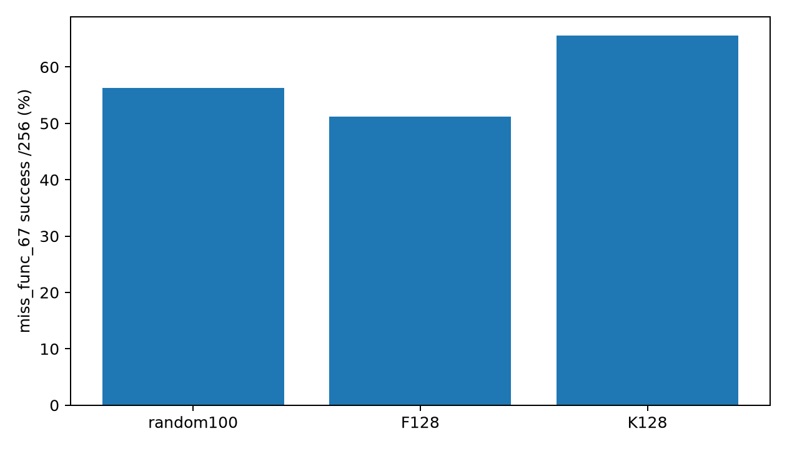

# 第二题：预条件投影与随机100

Question: multi_turn_miss_func_67

| Model | Success /256 | Rate |
|---|---:|---:|
| random100 | 144 | 56.25% |
| f | 131 | 51.17% |
| k | 168 | 65.62% |

| Model | Delta vs random pp | Paired95% pp | Holm p |
|---|---:|---|---:|
| f | -5.08 | [-13.671875, 3.515625] | 0.2944 |
| k | +9.38 | [0.78125, 17.96875] | 0.08007 |

- Exploratory second question chosen after previous diagnostic outcomes; not benchmark generalization.
- Q1 selects F/K rollout counts; new task uses its own reward gradients for top100/200 selection.
- Single training seed, two new selected models; random100 checkpoint reused.
- Reasoning retained in gradients, strict-v2 history in generation.
- If either frozen probe prefix has zero reward variance, record degeneracy and stop rather than silently resample.
