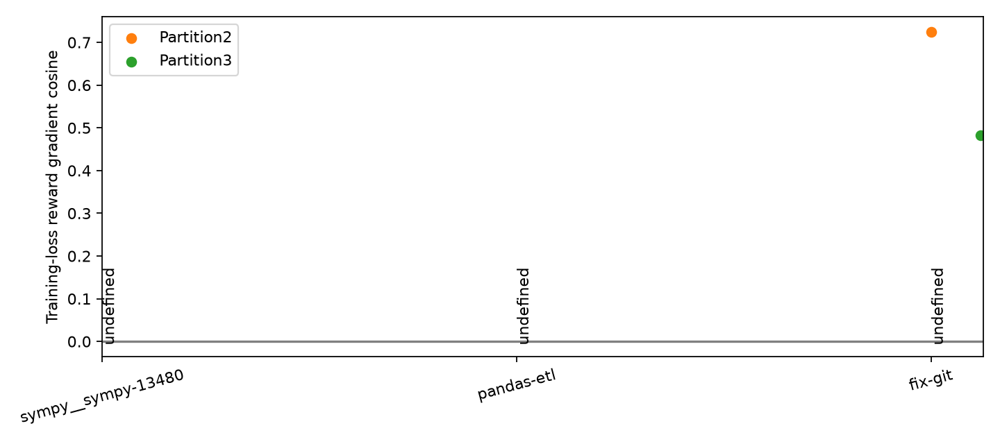

# OTA · Qwen3-8B base · 训练loss对齐probe

已分析3/3题，每题32条新rollout。

| 任务 | 成功/32 | cosine8 | cosine32 | 其他两划分 | 目标tokens保留率 |
|---|---:|---:|---:|---|---:|
| sympy__sympy-13480 | 0 | undefined | undefined | undefined, undefined | 64.11% |
| pandas-etl | 0 | undefined | undefined | undefined, undefined | 52.32% |
| fix-git | 2 | undefined | undefined | 0.72406, 0.48309 | 74.01% |

Loss直接调用原始训练栈，reward按rollout中心化，整个half按有效目标tokens归一化。该诊断不能直接解释为严格on-policy成功率梯度。

- Only3selected tasks; no benchmark-widegeneralization claim.
- HistoricalSFT-modelresults used in taskselection; freshbase outcomes notused toselect/replace tasks.
- Threepartitions sharedata; no independent-replicationCI.
- Allsame reward half yields exactzero andundefinedcosine; no balancing or replacement.
- Nooptimizerupdate; optimizer preconditioning/weightdecay/clipping are outside thisloss-gradient diagnostic.
