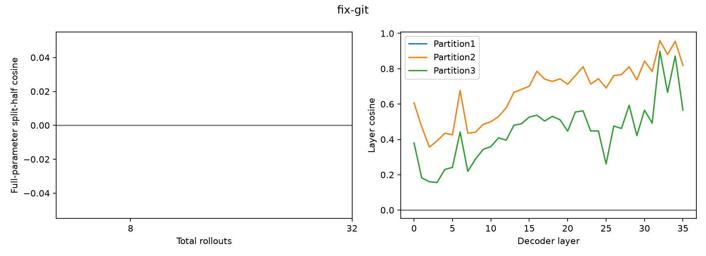

# fix-git：原始Qwen3-8B训练loss梯度

成功2/32；SFT样本72条；截断后保留74.01%的原始训练目标tokens。

使用原OTA LLaMA-Factory编码和Trainer/Liger loss；全assistant监督、保留reasoning、32K截断。它是reward加权SFT-loss梯度，不是严格on-policy score gradient。

| 总rollouts | A/B成功数 | cosine | 范数A | 范数B |
|---:|---|---:|---:|---:|
| 8 | 1/0 | undefined | 0.7477 | 0.0000 |
| 32 | 2/0 | undefined | 0.5740 | 0.0000 |

| 固定16+16划分 | cosine | A/B目标token数 |
|---|---:|---|
| [0, 1] vs [2, 3] | undefined | 510605/464045 |
| [0, 2] vs [1, 3] | 0.72406 | 600639/374011 |
| [0, 3] vs [1, 2] | 0.48309 | 453486/521164 |

undefined表示至少一个half的梯度为零，不能当作cosine=0；三种划分共享数据。

- Only3selected tasks; no benchmark-widegeneralization claim.
- HistoricalSFT-modelresults used in taskselection; freshbase outcomes notused toselect/replace tasks.
- Threepartitions sharedata; no independent-replicationCI.
- Allsame reward half yields exactzero andundefinedcosine; no balancing or replacement.
- Nooptimizerupdate; optimizer preconditioning/weightdecay/clipping are outside thisloss-gradient diagnostic.

## 按reward划分的长度与梯度统计

| Reward | 样本数 | 平均目标tokens | 平均token NLL | 平均CE-sum梯度范数 |
|---|---:|---:|---:|---:|
| 0 | 30 | 31712.6 | 0.34187 | 230853.348 |
| 1 | 2 | 11636.0 | 0.33733 | 97842.064 |
