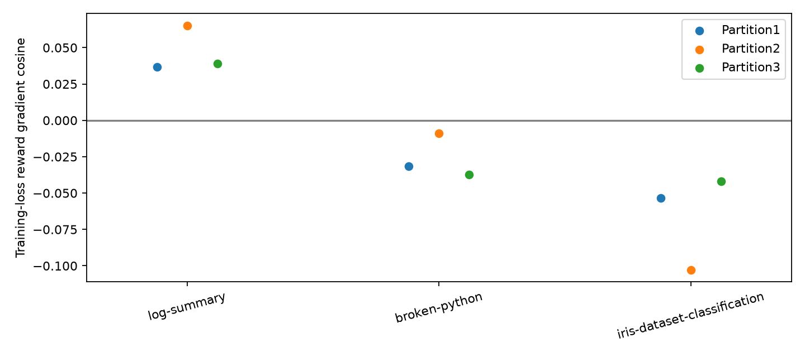

# OTA · Qwen3-8B base · 训练loss对齐probe

已分析3/3题，每题32条新rollout。

| 任务 | 平均score | 满分/32（仅描述） | cosine8 | cosine32 | 其他两划分 | 目标tokens保留率 |
|---|---:|---:|---:|---|---:|
| log-summary | 0.18750 | 6 | undefined | 0.03684 | 0.06516, 0.03905 | 100.00% |
| broken-python | 0.87500 | 28 | -0.07301 | -0.03152 | -0.00900, -0.03748 | 100.00% |
| iris-dataset-classification | 0.67188 | 16 | undefined | -0.05357 | -0.10270, -0.04200 | 100.00% |

Loss直接调用原始训练栈，原始score按rollout中心化；每半使用自己的平均score，不二值化、不除以标准差，整个half按有效目标tokens归一化。该诊断不能直接解释为严格on-policy成功率梯度。

- Adaptive easy-task selection from a disclosed8-sample pilot; all screening outcomes retained.
- Formal32rollouts use disjoint seeds and do not include screening data.
- Threepartitions share samples, not independent replications.
- Constant score half gives zero gradient and undefined cosine.
- Score weighted originalSFT loss, not exact on-policy gradient; retain reasoning, truncation, and copied contexts.
- No optimizer update; no claim of improved success from cosine alone.
- Score-based weighting supersedes binary mapping at explicit user request, before any formal sample or gradient computation.
