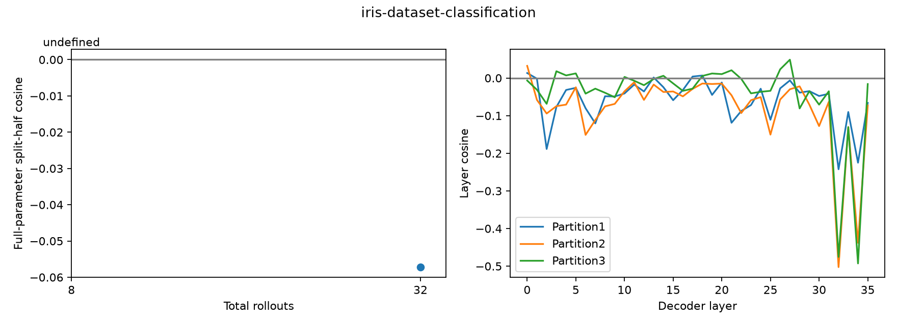

# iris-dataset-classification：原始Qwen3-8B训练loss梯度

平均binary reward 0.50000；满分16/32（仅描述）；SFT样本32条；截断后保留100.00%的原始训练目标tokens。

使用原OTA LLaMA-Factory编码和Trainer/Liger loss；全assistant监督、保留reasoning、32K截断。binary=1[官方score==1]；它是reward加权SFT-loss梯度，不是严格on-policy score gradient。

| 总rollouts | A/B满分数（仅描述） | cosine | 范数A | 范数B |
|---:|---|---:|---:|---:|
| 8 | 4/2 | undefined | 0.0000 | 0.9635 |
| 32 | 11/5 | -0.05720 | 0.3254 | 0.3249 |

| 固定16+16划分 | cosine | A/B目标token数 |
|---|---:|---|
| [0, 1] vs [2, 3] | -0.05720 | 74829/89848 |
| [0, 2] vs [1, 3] | -0.08386 | 89686/74991 |
| [0, 3] vs [1, 2] | -0.02931 | 74398/90279 |

undefined表示至少一个half的梯度为零，不能当作cosine=0；三种划分共享数据。

- Adaptive easy-task selection from a disclosed8-sample pilot; all screening outcomes retained.
- Formal32rollouts use disjoint seeds and do not include screening data.
- Threepartitions share samples, not independent replications.
- Constant score half gives zero gradient and undefined cosine.
- Score weighted originalSFT loss, not exact on-policy gradient; retain reasoning, truncation, and copied contexts.
- No optimizer update; no claim of improved success from cosine alone.
- Score-based weighting supersedes binary mapping at explicit user request, before any formal sample or gradient computation.

## 按binary reward划分的长度与梯度统计

| Reward | 样本数 | 平均目标tokens | 平均token NLL | 平均CE-sum梯度范数 |
|---|---:|---:|---:|---:|
| 0.0 | 16 | 5589.8 | 0.21076 | 19976.412 |
| 1.0 | 16 | 4702.5 | 0.21749 | 17349.652 |
