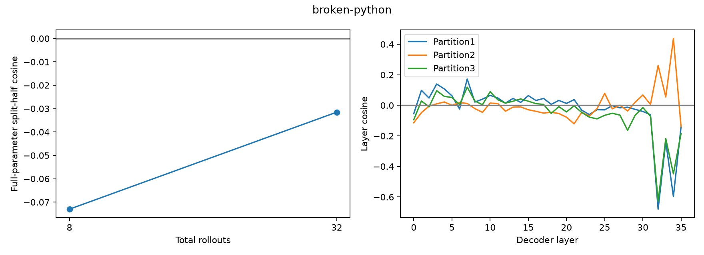

# broken-python：原始Qwen3-8B训练loss梯度

平均score 0.87500；满分28/32（仅描述）；SFT样本32条；截断后保留100.00%的原始训练目标tokens。

使用原OTA LLaMA-Factory编码和Trainer/Liger loss；全assistant监督、保留reasoning、32K截断。它是reward加权SFT-loss梯度，不是严格on-policy score gradient。

| 总rollouts | A/B满分数（仅描述） | cosine | 范数A | 范数B |
|---:|---|---:|---:|---:|
| 8 | 3/3 | -0.07301 | 2.2774 | 1.2895 |
| 32 | 14/14 | -0.03152 | 0.7849 | 0.5296 |

| 固定16+16划分 | cosine | A/B目标token数 |
|---|---:|---|
| [0, 1] vs [2, 3] | -0.03152 | 74250/66180 |
| [0, 2] vs [1, 3] | -0.00900 | 72241/68189 |
| [0, 3] vs [1, 2] | -0.03748 | 70775/69655 |

undefined表示至少一个half的梯度为零，不能当作cosine=0；三种划分共享数据。

- Adaptive easy-task selection from a disclosed8-sample pilot; all screening outcomes retained.
- Formal32rollouts use disjoint seeds and do not include screening data.
- Threepartitions share samples, not independent replications.
- Constant score half gives zero gradient and undefined cosine.
- Score weighted originalSFT loss, not exact on-policy gradient; retain reasoning, truncation, and copied contexts.
- No optimizer update; no claim of improved success from cosine alone.
- Score-based weighting supersedes binary mapping at explicit user request, before any formal sample or gradient computation.

## 按原始score划分的长度与梯度统计

| Reward | 样本数 | 平均目标tokens | 平均token NLL | 平均CE-sum梯度范数 |
|---|---:|---:|---:|---:|
| 0.0 | 4 | 6628.5 | 0.30387 | 39204.948 |
| 1.0 | 28 | 4068.4 | 0.27333 | 27471.650 |
