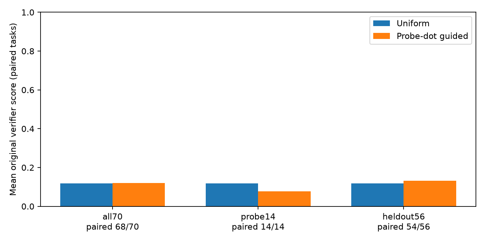
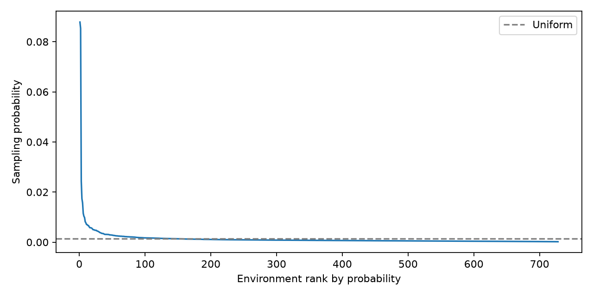

# 环境重采样：Uniform vs probe-dot guided

本轮没有显示出可靠的收益。主要留出比较基于两模型都有原verifier分数的54道题：Uniform均值0.11776，Guided均值0.13151，差值+0.01375；task-bootstrap95%区间为[-0.09076,0.11481]，包含0。完整70题中确认全通过数为7与5，两模型各有1条无verifier分数，保留null。

两道实际参与归因的probe题，单次评测分别从0.6666降至0.3333、从1.0降至0.75；单次采样不能据此估计成功率的稳定变化。采样覆盖334个环境，其中task_9288被抽中70次，再生成的70条均得到原verifier的0分。该现象与采样集中度值得关注，但本轮数据不足以确定其因果作用。

两个续训分支均为728条新轨迹、23个optimizer steps；监督目标tokens分别为4,837,691与4,866,532，相差约0.60%。只使用了2道有效probe题，且仅有一个训练seed和每题一次最终评测，结论应视为一次有限的有效性检验。

原verifier没有返回分数时保留null，不人为补0。未参与probe的56题为主要比较；置信区间基于两模型都有原verifier分数的同一批题目。

| 子集 | 计划题数 | 配对已评分题数 | Uniform配对均值 | Guided配对均值 | 配对差值 | bootstrap95%区间 |
|---|---:|---:|---:|---:|---:|---|
| all70 | 70 | 68 | 0.11802 | 0.12036 | 0.00234 | [-0.08065180147058823, 0.08444816176470586] |
| probe14 | 14 | 14 | 0.11904 | 0.07738 | -0.04166 | [-0.10118571428571428, 0.0] |
| heldout56 | 56 | 54 | 0.11776 | 0.13151 | 0.01375 | [-0.09075925925925926, 0.11481481481481481] |

## 原verifier覆盖率与缺失结果

| 子集 | Uniform已评分/计划 | Guided已评分/计划 | 完整子集差值的缺失结果上下界 |
|---|---:|---:|---|
| all70 | 69/70 | 69/70 | [-0.012013809523809524, 0.016557619047619047] |
| probe14 | 14/14 | 14/14 | [-0.04166428571428571, -0.04166428571428571] |
| heldout56 | 55/56 | 55/56 | [-0.004601190476190476, 0.03111309523809524] |

上下界是允许未知结果在0至1范围变化得到的不确定性范围，不是给缺失结果填分。

## 数据与训练量

| 阶段 | 轨迹数 | SFT片段数 | 有分数样本的教师均值 |
|---|---:|---:|---:|
| teacher-batch1 | 728 | 728 | 0.78297 |
| teacher-uniform | 728 | 728 | 0.77610 |
| teacher-guided | 728 | 728 | 0.74451 |

| 训练阶段 | optimizer steps | 目标tokens | 原始目标tokens保留率 |
|---|---:|---:|---:|
| sft-epoch1 | 23 | 4895804 | 99.49% |
| sft-uniform | 23 | 4837691 | 99.18% |
| sft-guided | 23 | 4866532 | 99.41% |

## 再生成的实际表现

| 高概率环境 | 首批教师score | 抽样次数 | 新轨迹有分数/总数 | 新轨迹平均score |
|---|---:|---:|---:|---:|
| task_3480 | 0.00000 | 55 | 55/55 | 0.80000 |
| task_9288 | 0.00000 | 70 | 70/70 | 0.00000 |
| task_4995 | 1.00000 | 22 | 22/22 | 0.95455 |
| task_2507 | 1.00000 | 15 | 15/15 | 0.40000 |
| task_9487 | 1.00000 | 15 | 15/15 | 0.80000 |
| task_7374 | 1.00000 | 7 | 7/7 | 1.00000 |
| task_1670 | 1.00000 | 7 | 7/7 | 1.00000 |
| task_6646 | 1.00000 | 5 | 5/5 | 1.00000 |
| task_2721 | 1.00000 | 4 | 4/4 | 0.75000 |
| task_7558 | 1.00000 | 4 | 4/4 | 1.00000 |

## 选样

{"candidate_trajectories": 728, "generated_trajectories_planned": 728, "unique_sampled_environments": 334, "effective_sample_size": 55.44353931478941, "max_probability": 0.08784424272258302, "max_environment_repeats": 70}

有效probe题数：2；平均probe范数：0.11931669121982601。

## 限制

- Single training seed and one eval rollout/task/model; task bootstrap excludes training-seed uncertainty.
- Heldout56 is primary. Probe14 was used for feedback and is not independent validation.
- Missing original verifier scores remain null. No custom failure zeros. Paired estimates condition on joint score availability; report coverage and full-subset unknown-outcome bounds.
- Probe questions require32 original verifier scores and nonconstant outcomes; incomplete questions are excluded without replacement.
- Equal728 new trajectories per branch; supervised token counts and exported segment counts may differ.
- Uniform visits each environment once; guided samples with replacement, so coverage/multiplicity differ.
- Raw full-parameter SFT-loss gradient dots, not AdamW-preconditioned influence or exact on-policy gradients.
- All728 RL training tasks are NL2Bash/terminal-automation; TB-dev covers broader task categories.
- Budget failures without an accepted assistant turn have zero exported SFT rows; rejected raw generation remains preserved.

补充抽查：task_9288 的 t0006 轨迹把“取前五个匹配”理解成必须凑足五个文件，额外创建了test3/4/5.example.com。原verifier通过cmp与固定的两行期望输出精确比较，因此该条得到0分。这是其中一条已核查的具体原因，不能自动推广为70条的共同原因，也尚不能据此认定verifier存在错误。见[案例记录](explanation-case-task9288.json)。
