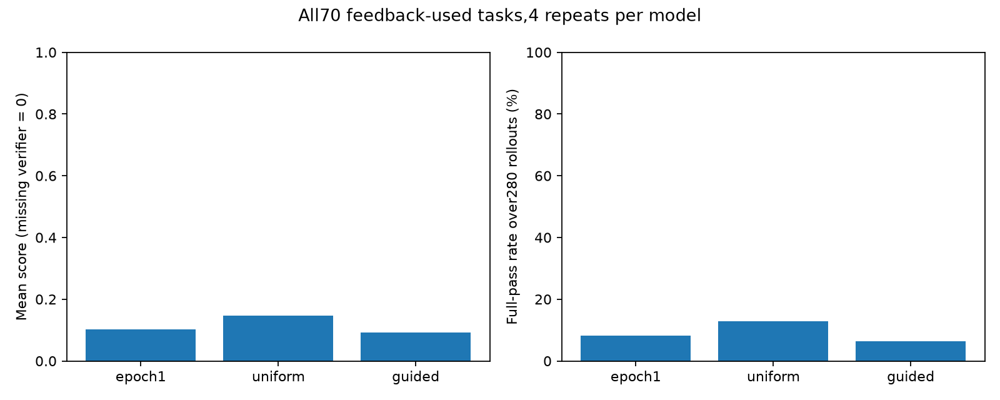
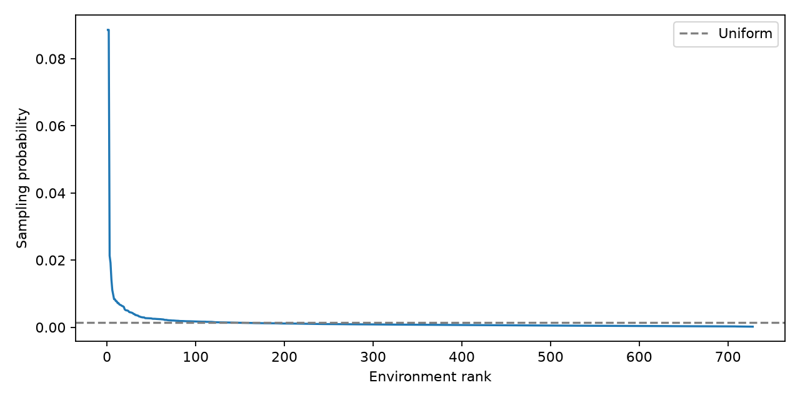
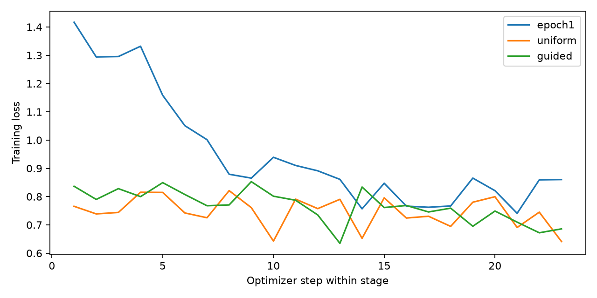

# 全70题×4次：第一轮、Uniform与新Guided

所有70题用于probe反馈；本表不能解读为独立留出集结果。缺少原verifier分数的已结束尝试按用户要求计0，raw_score与异常保持原样。

| 模型 | 尝试数 | 平均score | 满分次数 | 满分率 | 缺分计0次数 | 4次中至少一次满分的题数 |
|---|---:|---:|---:|---:|---:|---:|
| epoch1 | 280 | 0.10209 | 23 | 8.21% | 2 | 14/70 |
| uniform | 280 | 0.14684 | 36 | 12.86% | 4 | 18/70 |
| guided | 280 | 0.09311 | 18 | 6.43% | 2 | 14/70 |

先将每题4次结果取均值，再按相同70道题进行配对比较和bootstrap。

| 比较 | 平均score差 | 95%题目bootstrap区间 | 满分率差(pp) |
|---|---:|---|---:|
| uniform_minus_epoch1 | +0.04476 | [0.0033391488095238105, 0.09167142857142857] | +4.643 |
| guided_minus_epoch1 | -0.00898 | [-0.04238072654660155, 0.02219190242165242] | -1.786 |
| guided_minus_uniform | -0.05373 | [-0.09684912723850223, -0.016974613349613348] | -6.429 |

有效probe题数：20；排除恒分题数：50。

{"candidate_trajectories": 728, "generated_trajectories_planned": 728, "unique_sampled_environments": 328, "effective_sample_size": 53.73383878439908, "max_probability": 0.08862036076174189, "max_environment_repeats": 72}

## 训练量

| 模型 | 本阶段epochs | 本阶段optimizer steps | 监督目标tokens |
|---|---:|---:|---:|
| epoch1 | 1.0 | 23 | 4895804 |
| uniform | 1.0 | 23 | 4837691 |
| guided | 1.0 | 23 | 4882779 |

## 限制

- All70 tasks provided probe feedback; this is feedback-used benchmark performance, not independent heldout generalization.
- Only one training seed. Four inference repeats reduce single-rollout noise but do not measure training-seed variance.
- Missing terminal verifier scores explicitly count as0 per user; original rewards/errors and missingness counts are retained.
- Uniform repeats1 are reused from009, repeats2–4 are new; same pinned checkpoint, harness, task images, sampling and post-training seeds.
- Epoch1/probe seeds differ from post-training seeds; Uniform and newGuided share task-repeat seeds.
- Equal728 regenerated teacher trajectories, not necessarily equal unique environments or target tokens.
- Raw full-parameter SFT-loss gradient dots; not exact AdamW-preconditioned influence.
