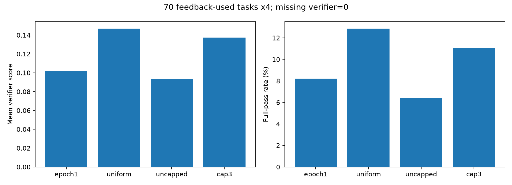

# 上限3环境重采样：完整70题×4次结果

| 模型 | 次数 | 平均score | 满分次数 | 满分率 | 缺分记0 |
|---|---:|---:|---:|---:|---:|
| epoch1 | 280 | 0.10209 | 23 | 8.21% | 2 |
| uniform | 280 | 0.14684 | 36 | 12.86% | 4 |
| uncapped | 280 | 0.09311 | 18 | 6.43% | 2 |
| cap3 | 280 | 0.13741 | 31 | 11.07% | 5 |

每题先平均4次，再对70题做配对bootstrap；不是280个独立问题。

| 比较 | 平均score差 | 95%题目bootstrap区间 | 满分率差(pp) |
|---|---:|---|---:|
| cap3_minus_uniform | -0.00944 | [-0.063382451007326, 0.04376178869047618] | -1.786 |
| cap3_minus_uncapped | +0.04429 | [-0.002305416666666666, 0.09504024475986973] | +4.643 |
| cap3_minus_epoch1 | +0.03532 | [-0.0002495421245421234, 0.07154834478021978] | +2.857 |

## 抽样与训练

{"candidate_environments": 728, "planned_teacher_trajectories": 728, "unique_sampled_environments": 526, "max_environment_repeats": 3, "max_probability": 0.004120879120879121, "probability_effective_environments": 469.8493434040367, "empirical_effective_environments": 423.30990415335464, "environments_at_cap3": 60, "task9288_occurrences": 3}
{"epoch": 1.0, "steps": 23, "sft_rows": 728, "target_tokens": 4773869, "original_target_tokens": 4784672, "loss": 0.7395454541496609}

## 限制

- All70tasks supplied probe feedback; not independent heldout generalization.
- Single training seed. Task bootstrap describes variability across these70tasks, not training-seed variance.
- Fresh teacher generation with new seeds; comparison changes both resampling cap and realized teacher trajectories, not an exact deletion-only ablation.
- Probability cap plus dependent count rounding changes the sampling joint distribution; counts are not independent multinomial draws.
- Failure trajectories retained, no reward-based filtering. Missing terminal verifier scores count0 with rawscore/errors preserved.
- Original firstepoch/Uniform/uncapped Guided280outcomes reused; cap3 uses identical post-training task-repeat seeds.
